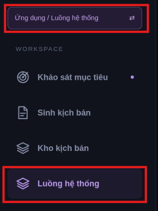
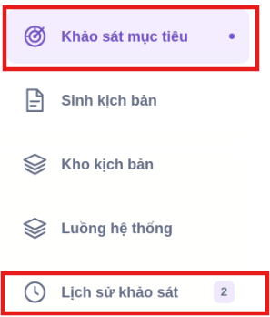

# SOC Assessment Platform

Source package for an evidence-grounded survey console and planning-only Scenario Agent.

## Components

- `GUI/`: survey console, telemetry inspection, scenario handoff, and guarded CALDERA integration.
- `scenario_agent/`: catalog-grounded scenario planning and schema validation.
- `final_template/`: shared contracts and templates.
- `scenario_agent/scenarios/`: scenario inputs.
- `scenario_agent/abilities_dvwa/`: bounded DVWA ability definitions.

## Screenshots

Representative UI previews from local review:




These images show static UI layout only. They are not evidence of live endpoint execution or SOC detection.

## Safety boundary

This package contains source, schemas, examples, and scenario data only. Runtime outputs, credentials, virtual environments, indexes, model files, and lab-specific secret configuration are intentionally excluded. Review scope and authorization before any lab execution.

## Setup

GUI:

```bash
cd GUI
python -m venv .venv
.venv\Scripts\activate  # Windows
# source .venv/bin/activate  # Linux
pip install -e .
copy config.example.json config.json  # Windows
# cp config.example.json config.json  # Linux
python app.py
```

Scenario Agent:

```bash
cd scenario_agent
python -m venv .venv
.venv\Scripts\activate  # Windows
# source .venv/bin/activate  # Linux
pip install -e .
python -m scenario_agent doctor
python -m unittest discover -s tests -v
```

Build catalog/RAG derived data only from included source data. Never commit `.env`, `config.json`, API keys, host credentials, runtime outputs, or indexes.
